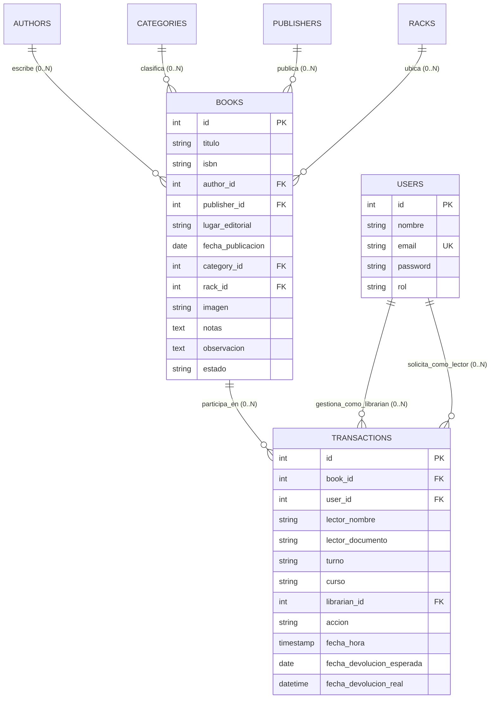
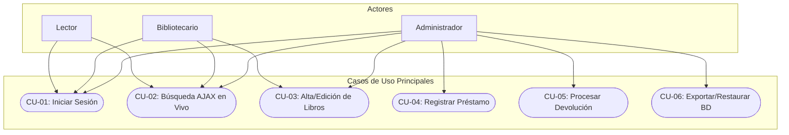

# 📚 Documentación Integral del Sistema de Gestión de Biblioteca

> [!NOTE]
> Esta documentación sigue la metodología **Diátaxis** (desarrollada por Daniele Procida y recomendada para arquitectura de software moderna), estructurada en cuatro cuadrantes de conocimiento: **Tutoriales**, **Guías Prácticas**, **Referencia Técnica** y **Explicación Conceptual**, complementada con un registro formal de **Decisiones de Arquitectura (ADRs)** y pautas de **Docs-as-Code**.

---

```
                       ORIENTADO AL APRENDIZAJE
                                  ▲
                                  │
               TUTORIALES         │        EXPLICACIÓN
          (Paso a paso inicial)   │   (Conceptos y Arquitectura)
                                  │
    PRACTICAL ────────────────────┼──────────────────── THEORETICAL
    (Orientado a la acción)       │                    (Orientado al conocimiento)
                                  │
            GUÍAS PRÁCTICAS       │        REFERENCIA
           (Tareas concretas)     │   (Especificación y Datos)
                                  │
                                  ▼
                        ORIENTADO A LA TAREA
```

---

## 🧭 Índice General
1. [🎓 Cuadrante 1: Tutoriales (Tutorials / Getting Started)](#-cuadrante-1-tutoriales-tutorials)
2. [🛠️ Cuadrante 2: Guías Prácticas (How-to Guides)](#️-cuadrante-2-guías-prácticas-how-to-guides)
3. [📖 Cuadrante 3: Referencia Técnica (Reference)](#-cuadrante-3-referencia-técnica-reference)
   - [3.1 Requisitos Funcionales y No Funcionales](#31-requisitos-funcionales-y-no-funcionales)
   - [3.2 Matriz de Trazabilidad de Requisitos](#32-matriz-de-trazabilidad-de-requisitos)
   - [3.3 Diccionario de Datos y Esquema de Base de Datos](#33-diccionario-de-datos-y-esquema-de-base-de-datos)
   - [3.4 Diagrama Entidad-Relación (DER)](#34-diagrama-entidad-relación-der)
   - [3.5 Especificación de Endpoints y Rutas HTTP](#35-especificación-de-endpoints-y-rutas-http)
4. [💡 Cuadrante 4: Explicación y Conceptos (Explanation)](#-cuadrante-4-explicación-y-conceptos-explanation)
   - [4.1 Arquitectura y Filosofía del Sistema](#41-arquitectura-y-filosofía-del-sistema)
   - [4.2 Reglas de Negocio del Dominio (RN)](#42-reglas-de-negocio-del-dominio-rn)
   - [4.3 Casos de Uso (CU) y Diagramas de Interacción](#43-casos-de-uso-cu-y-diagramas-de-interacción)
   - [4.4 Historial Detallado de Cambios](#44-historial-detallado-de-cambios)
5. [🏛️ Registros de Decisiones de Arquitectura (ADRs)](#️-registros-de-decisiones-de-arquitectura-adrs)
6. [🤖 Directrices para Agentes de IA y Contribuidores (AGENTS)](#-directrices-para-agentes-de-ia-y-contribuidores)

---

## 🎓 Cuadrante 1: Tutoriales (Tutorials)
*Orientado al aprendizaje. Guía paso a paso para que un desarrollador o usuario nuevo instale, inicialice y experimente el sistema por primera vez sin fricción.*

### Tutorial: Puesta en marcha del entorno local desde cero

Este tutorial te enseñará a configurar la base de datos, levantar el servidor web local y realizar tu primer inicio de sesión como Administrador en menos de 5 minutos.

#### Prerrequisitos
- Tener instalado **PHP 8.0 o superior** con la extensión `pdo_mysql` habilitada.
- Tener instalado **MySQL 8.0+** o **MariaDB 10.4+** (mediante XAMPP o standalone).

#### Paso 1: Clonar o ubicar el repositorio
Asegúrate de que la carpeta del proyecto se encuentre en el directorio raíz o en `c:\xampp\htdocs\`:
```powershell
# Verificar la presencia del código
Get-ChildItem -Path "c:\xampp\htdocs\x\Gestion-de-biblioteca-main\Gestion-de-biblioteca-main"
```

#### Paso 2: Crear e importar la base de datos
1. Inicia el servicio de MySQL en tu panel de control de XAMPP.
2. Abre tu cliente SQL o terminal y ejecuta:
```sql
CREATE DATABASE IF NOT EXISTS library_system CHARACTER SET utf8mb4 COLLATE utf8mb4_unicode_ci;
```
3. Importa el archivo de esquema inicial [`database.sql`](file:///c:/xampp/htdocs/x/Gestion-de-biblioteca-main/Gestion-de-biblioteca-main/database.sql):
```bash
mysql -u root library_system < database.sql
```

#### Paso 3: Verificar la configuración de conexión
Abre [`config.php`](file:///c:/xampp/htdocs/x/Gestion-de-biblioteca-main/Gestion-de-biblioteca-main/config.php) y constata los parámetros:
```php
$host = 'localhost';
$db   = 'library_system';
$user = 'root';
$pass = ''; // Por defecto en XAMPP suele estar vacío
```

#### Paso 4: Iniciar el servidor local
Puedes acceder vía Apache (`http://localhost/x/Gestion-de-biblioteca-main/...`) o iniciar el servidor embebido de PHP en el puerto 8000:
```powershell
php -S localhost:8000 -t "c:\xampp\htdocs\x\Gestion-de-biblioteca-main\Gestion-de-biblioteca-main"
```

#### Paso 5: Primer inicio de sesión
1. Abre tu navegador en `http://localhost:8000/login.php`.
2. Ingresa las credenciales maestras:
   - **Correo Electrónico**: `admin@biblioteca.com`
   - **Contraseña**: `admin123`
3. Serás redirigido al [`dashboard.php`](file:///c:/xampp/htdocs/x/Gestion-de-biblioteca-main/Gestion-de-biblioteca-main/dashboard.php) donde podrás ver las estadísticas del catálogo y la hora de operación.

---

## 🛠️ Cuadrante 2: Guías Prácticas (How-to Guides)
*Orientadas a resolver problemas o tareas concretas de forma concisa y directa.*

### Guía 2.1: ¿Cómo registrar un nuevo libro en el catálogo?
1. Inicia sesión con rol **Administrador** o **Bibliotecario**.
2. Dirígete a la sección **Libros** o accede a [`pages/add_book.php`](file:///c:/xampp/htdocs/x/Gestion-de-biblioteca-main/Gestion-de-biblioteca-main/pages/add_book.php).
3. Completa los campos del formulario:
   - **Título\***: Nombre de la obra.
   - **Autor\***: Selección de autor registrado.
   - **N° de Inventario / ISBN**: Código único identificatorio del ejemplar físico.
   - **Editorial**: Casa editorial del libro.
   - **Lugar de la Editorial**: Ciudad o país de publicación (ej. *Buenos Aires*, *Madrid*).
   - **Fecha de Publicación**: Fecha en que fue publicado el libro.
   - **Categoría**: Clasificación temática.
   - **Portada**: Imagen de portada (`.jpg`, `.png`, `.webp`, `.gif`) almacenada en [`uploads/books/`](file:///c:/xampp/htdocs/x/Gestion-de-biblioteca-main/Gestion-de-biblioteca-main/uploads/books).
   - **Notas (opcional)**: Notas internas de catalogación o estado del ejemplar.
   - **Observación (opcional)**: Observaciones complementarias sobre el libro.
   - **Estado Inicial**: `Disponible` por defecto.
4. Haz clic en **"Guardar Libro"**.

### Guía 2.2: ¿Cómo registrar un préstamo y procesar su devolución?
#### Para prestar un libro:
1. Accede a [`pages/issue_books.php`](file:///c:/xampp/htdocs/x/Gestion-de-biblioteca-main/Gestion-de-biblioteca-main/pages/issue_books.php).
2. En la sección **"Registrar Préstamo"**:
   - **Libro Disponible**: Busca por título, autor o número de inventario. Solo se listan libros con estado `Disponible`.
   - **Alumno/a (Lector)**: Nombre y apellido del estudiante o solicitante.
   - **Turno**: Selecciona entre `Mañana`, `Tarde` o `Noche`.
   - **Curso**: Ingresa el curso del alumno (ej. *3ro A*, *1º 2da*).
   - **Documento / DNI (opcional)**: Documento numérico del solicitante.
3. Presiona **"Registrar Préstamo"**. El sistema cambiará el estado del libro a `Prestado` y persistirá la transacción con auditoría completa.

#### Para registrar la devolución:
1. En [`pages/issue_books.php`](file:///c:/xampp/htdocs/x/Gestion-de-biblioteca-main/Gestion-de-biblioteca-main/pages/issue_books.php), localiza el ejemplar en la tabla de **Libros Actualmente Prestados**, donde se detallan: *Nº Inv.*, *Fecha*, *Título*, *Autor*, *Alumno/a*, *Turno*, *Curso*.
2. Haz clic en el botón verde **"Devolver"**.
3. El sistema registrará la acción de devolución con su `fecha_devolucion_real = NOW()` y restituirá el libro a estado `Disponible`.

### Guía 2.3: ¿Cómo ejecutar la migración masiva de catálogos (Aguapay / ISO 2709)?
1. Asegúrate de que el archivo ISO 2709 exportado desde Aguapay se encuentre en [`scripts_migracion/aguapay.iso`](file:///c:/xampp/htdocs/x/Gestion-de-biblioteca-main/Gestion-de-biblioteca-main/scripts_migracion/aguapay.iso).
2. Ejecuta el script de migración por consola:
```powershell
php "c:\xampp\htdocs\x\Gestion-de-biblioteca-main\Gestion-de-biblioteca-main\scripts_migracion\migrate_aguapay.php"
```
3. El script normalizará autores, categorías, editoriales e insertará los registros bibliográficos aplicando transacciones seguras por lotes.

### Guía 2.4: ¿Cómo crear y administrar usuarios con roles diferenciados (RBAC)?
1. Ingresa a [`pages/users.php`](file:///c:/xampp/htdocs/x/Gestion-de-biblioteca-main/Gestion-de-biblioteca-main/pages/users.php) (requiere rol de `Administrador`).
2. En el formulario de alta, ingresa:
   - Nombre de usuario.
   - Correo electrónico (debe ser único).
   - Contraseña inicial (será encriptada mediante `password_hash`).
   - Rol: `Administrador`, `Bibliotecario` o `Lector`.
3. Haz clic en **"Registrar Usuario"**.

### Guía 2.5: ¿Cómo exportar y restaurar copias de seguridad de la base de datos?
1. Inicia sesión como **Administrador** y dirígete a la pestaña **Respaldo BD** en la barra lateral ([`pages/db_tools.php`](file:///c:/xampp/htdocs/x/Gestion-de-biblioteca-main/Gestion-de-biblioteca-main/pages/db_tools.php)).
2. **Para Exportar (Descargar Backup)**:
   - Haz clic en **"📥 Descargar Copia de Seguridad (.sql)"**.
   - El sistema generará y descargará un volcado SQL estructurado (`backup_library_system_YYYY-MM-DD_HH-mm-ss.sql`) con todas las tablas, relaciones y datos de la biblioteca.
3. **Para Restaurar (Importar Backup)**:
   - En la tarjeta **Restaurar Base de Datos**, presiona **"Seleccionar Archivo SQL"** y elige tu archivo `.sql`.
   - Marca la casilla de confirmación: *"Entiendo los riesgos y confirmo que deseo restaurar la base de datos"*.
   - Presiona **"📤 Restaurar Base de Datos"** y confirma en el cuadro de diálogo.
   - El sistema ejecutará las sentencias SQL deshabilitando temporalmente las claves foráneas para preservar integridad y notificará la cantidad de sentencias ejecutadas.

### Guía 2.6: ¿Cómo alojar el sistema en servidor Nginx y acceder desde cualquier PC por WiFi?
1. **En el servidor Linux (Ubuntu/Debian)**:
   - Clona o copia el repositorio a tu servidor.
   - Ejecuta el script de despliegue automatizado:
   ```bash
   sudo bash deploy/deploy_nginx.sh
   ```
   - El script instalará Nginx, MySQL, PHP-FPM, configurará la base de datos, los permisos y el firewall.
2. **Obtener la dirección IP local del servidor en la red WiFi**:
   - En el servidor ejecuta: `hostname -I | awk '{print $1}'` (ejemplo de IP obtenida: `192.168.1.150`).
3. **Acceder desde cualquier computadora, notebook o tablet en la misma red WiFi**:
   - Abre el navegador web (Google Chrome, Firefox, Microsoft Edge, Safari) en cualquier equipo conectado a la misma red WiFi.
   - Escribe en la barra de direcciones:
   ```
   http://192.168.1.150/
   ```
   - ¡Listo! Podrás iniciar sesión con las credenciales de administrador (`admin@biblioteca.com` / `admin123`) y operar la biblioteca de manera simultánea desde varias estaciones de trabajo.

---

## 📖 Cuadrante 3: Referencia Técnica (Reference)
*Especificaciones técnicas formales, diccionarios de datos, requisitos y contratos de la API.*

### 3.1 Requisitos Funcionales y No Funcionales

#### Requisitos Funcionales (RF)
* **RF-01 (Autenticación y Control de Accesos - RBAC)**: El sistema debe autenticar a los usuarios mediante credenciales encriptadas y restringir el acceso a los módulos operativos de acuerdo con el rol asignado (`Administrador`, `Bibliotecario`, `Lector`).
* **RF-02 (Gestión del Catálogo Bibliográfico Extendido)**: El sistema debe proporcionar operaciones CRUD para libros, incluyendo portada, número de inventario/ISBN, autor, categoría, editorial, lugar de editorial, fecha de publicación, estantería, notas internas y observaciones.
* **RF-03 (Búsqueda en Tiempo Real y Paginación Asíncrona)**: El sistema debe permitir búsquedas multicriterio instantáneas mediante AJAX (título, autor, inventario, categoría, editorial, lugar editorial) con paginación optimizada a 25 registros por página.
* **RF-04 (Gestión del Ciclo de Préstamos y Devoluciones con Turno y Curso)**: El sistema debe emitir préstamos a ejemplares disponibles registrando alumno/a, documento, turno escolar (`Mañana`, `Tarde`, `Noche`) y curso (ej. "3ro A"), y permitir la devolución con 1 clic registrando la fecha/hora real de restitución.
* **RF-05 (Tablero de Control e Indicadores en Vivo)**: El sistema debe presentar un panel informativo consolidado en tiempo real con recuento de inventario, estado de préstamos y el estado operativo del establecimiento (Abierto/Cerrado) basado en horarios configurados.
* **RF-06 (Módulo de Respaldo y Restauración de Base de Datos)**: Los administradores deben poder descargar un volcado SQL estructurado completo (`.sql`) y restaurar la base de datos desde un archivo subido con control de integridad referencial.
* **RF-07 (Acceso Multiestación en Red Local WiFi vía Nginx)**: El sistema debe estar configurado para servirse mediante Nginx y PHP-FPM, permitiendo acceso simultáneo desde cualquier equipo conectado a la misma red WiFi mediante la IP del servidor.

#### Requisitos No Funcionales (RNF)
* **RNF-01 (Rendimiento y Tiempo de Respuesta)**: Las consultas de búsqueda y paginación sobre catálogos de más de 7.500 registros deben responder en menos de **300 ms** utilizando cláusulas SQL `LIMIT / OFFSET` e índices relacionales.
* **RNF-02 (Seguridad y Resistencia a Inyecciones SQL)**: Las contraseñas deben cifrarse con el algoritmo **bcrypt** (`password_hash`). La capa de acceso a datos debe operar mediante **PDO** con sentencias preparadas nativas y emulación desactivada (`ATTR_EMULATE_PREPARES => false`).
* **RNF-03 (Compatibilidad y Cero Dependencias Pesadas)**: La interfaz debe construirse en **CSS Vainilla** y JavaScript estándar (**Vanilla JS / XMLHttpRequest / Fetch**), permitiendo su funcionamiento en navegadores modernos y estaciones de trabajo heredadas sin frameworks pesados.
* **RNF-04 (Organización Modular y Mantenibilidad)**: El código fuente debe estar estructurado en directorios semánticos desacoplados (`pages/`, `api/`, `includes/`, `database/`, `deploy/`, `docs/`, `uploads/`).

---

### 3.2 Matriz de Trazabilidad de Requisitos

| ID Requisito | Descripción | Regla de Negocio | Caso de Uso | Componentes y Archivos | Tabla(s) BD | Estado |
| :---: | :--- | :---: | :---: | :--- | :--- | :---: |
| **RF-01** | Autenticación y RBAC | RN-02, RN-05 | CU-01 | [`login.php`](file:///c:/xampp/htdocs/x/Gestion-de-biblioteca-main/Gestion-de-biblioteca-main/login.php), [`auth.php`](file:///c:/xampp/htdocs/x/Gestion-de-biblioteca-main/Gestion-de-biblioteca-main/auth.php), [`includes/header.php`](file:///c:/xampp/htdocs/x/Gestion-de-biblioteca-main/Gestion-de-biblioteca-main/includes/header.php) | `users` | Operativo |
| **RF-02** | CRUD de Catálogo Extendido | RN-04 | CU-03 | [`pages/add_book.php`](file:///c:/xampp/htdocs/x/Gestion-de-biblioteca-main/Gestion-de-biblioteca-main/pages/add_book.php), [`pages/edit_book.php`](file:///c:/xampp/htdocs/x/Gestion-de-biblioteca-main/Gestion-de-biblioteca-main/pages/edit_book.php), [`pages/delete_book.php`](file:///c:/xampp/htdocs/x/Gestion-de-biblioteca-main/Gestion-de-biblioteca-main/pages/delete_book.php) | `books`, `authors`, `categories`, `publishers` | Operativo |
| **RF-03** | Búsqueda AJAX y Paginación | N/A | CU-02 | [`pages/books.php`](file:///c:/xampp/htdocs/x/Gestion-de-biblioteca-main/Gestion-de-biblioteca-main/pages/books.php), [`api/search_ajax.php`](file:///c:/xampp/htdocs/x/Gestion-de-biblioteca-main/Gestion-de-biblioteca-main/api/search_ajax.php) | `books`, `authors`, `categories`, `publishers` | Operativo |
| **RF-04** | Préstamos, Turnos y Cursos | RN-01, RN-03 | CU-04, CU-05 | [`pages/issue_books.php`](file:///c:/xampp/htdocs/x/Gestion-de-biblioteca-main/Gestion-de-biblioteca-main/pages/issue_books.php), [`api/search_books_json.php`](file:///c:/xampp/htdocs/x/Gestion-de-biblioteca-main/Gestion-de-biblioteca-main/api/search_books_json.php) | `books`, `transactions`, `users` | Operativo |
| **RF-05** | Dashboard e Indicadores | N/A | N/A | [`pages/dashboard.php`](file:///c:/xampp/htdocs/x/Gestion-de-biblioteca-main/Gestion-de-biblioteca-main/pages/dashboard.php) | `books`, `authors`, `categories`, `events_schedule` | Operativo |
| **RF-06** | Exportar / Importar Base de Datos | RN-02 | CU-06 | [`pages/db_tools.php`](file:///c:/xampp/htdocs/x/Gestion-de-biblioteca-main/Gestion-de-biblioteca-main/pages/db_tools.php), [`api/export_db.php`](file:///c:/xampp/htdocs/x/Gestion-de-biblioteca-main/Gestion-de-biblioteca-main/api/export_db.php) | Todas las tablas | Operativo |
| **RF-07** | Red Local WiFi con Nginx | N/A | N/A | [`deploy/nginx.conf`](file:///c:/xampp/htdocs/x/Gestion-de-biblioteca-main/Gestion-de-biblioteca-main/deploy/nginx.conf), [`deploy/deploy_nginx.sh`](file:///c:/xampp/htdocs/x/Gestion-de-biblioteca-main/Gestion-de-biblioteca-main/deploy/deploy_nginx.sh) | N/A | Operativo |
| **RNF-01** | Rendimiento < 300 ms | N/A | CU-02 | [`api/search_ajax.php`](file:///c:/xampp/htdocs/x/Gestion-de-biblioteca-main/Gestion-de-biblioteca-main/api/search_ajax.php) | Todas las tablas | Operativo |
| **RNF-02** | Cifrado y Sentencias Preparadas | RN-05 | CU-01 | [`config.php`](file:///c:/xampp/htdocs/x/Gestion-de-biblioteca-main/Gestion-de-biblioteca-main/config.php), [`auth.php`](file:///c:/xampp/htdocs/x/Gestion-de-biblioteca-main/Gestion-de-biblioteca-main/auth.php), [`pages/users.php`](file:///c:/xampp/htdocs/x/Gestion-de-biblioteca-main/Gestion-de-biblioteca-main/pages/users.php) | `users` | Operativo |
| **RNF-03** | Portabilidad y Cero Dependencias | N/A | CU-02, CU-04 | [`style.css`](file:///c:/xampp/htdocs/x/Gestion-de-biblioteca-main/Gestion-de-biblioteca-main/style.css), Vanilla JS | N/A | Operativo |
| **RNF-04** | Estructura Modular Limpia | N/A | N/A | `pages/`, `api/`, `includes/`, `database/`, `deploy/` | N/A | Operativo |

---

### 3.3 Diccionario de Datos y Esquema de Base de Datos

#### Tabla: `users`
Almacena las cuentas de acceso del personal y lectores.
- `id` (INT, PK, AUTO_INCREMENT): Identificador único del usuario.
- `nombre` (VARCHAR(100), NOT NULL): Nombre del usuario para presentación.
- `email` (VARCHAR(100), NOT NULL, UNIQUE): Correo electrónico y clave de inicio de sesión.
- `password` (VARCHAR(255), NOT NULL): Hash Bcrypt de la contraseña.
- `rol` (ENUM('Administrador', 'Bibliotecario', 'Lector'), NOT NULL, DEFAULT 'Lector'): Nivel de privilegios RBAC.
- `created_at` (TIMESTAMP, DEFAULT CURRENT_TIMESTAMP): Marca temporal de creación.

#### Tabla: `books`
Almacena el catálogo de títulos y ejemplares bibliográficos.
- `id` (INT, PK, AUTO_INCREMENT): Identificador del registro.
- `titulo` (VARCHAR(255), NOT NULL): Título principal del libro.
- `isbn` (VARCHAR(50), NULL): Número de inventario o código ISBN.
- `author_id` (INT, FK -> authors.id, NULL): Autor asociado (`ON DELETE SET NULL`).
- `publisher_id` (INT, FK -> publishers.id, NULL): Casa editorial (`ON DELETE SET NULL`).
- `lugar_editorial` (VARCHAR(255), NULL): **[NUEVO]** Lugar/ciudad de la editorial (ej. Buenos Aires).
- `fecha_publicacion` (DATE, NULL): **[NUEVO]** Fecha en que fue publicado el libro.
- `category_id` (INT, FK -> categories.id, NULL): Clasificación temática (`ON DELETE SET NULL`).
- `rack_id` (INT, FK -> racks.id, NULL): Estante o ubicación física (`ON DELETE SET NULL`).
- `imagen` (VARCHAR(255), NULL): Nombre de archivo de la portada en `uploads/books/`.
- `notas` (TEXT, NULL): **[NUEVO]** Notas internas del ejemplar (opcional).
- `observacion` (TEXT, NULL): **[NUEVO]** Observaciones adicionales sobre el libro.
- `estado` (ENUM('Disponible', 'Prestado', 'Extraviado'), DEFAULT 'Disponible'): Estado de circulación.
- `created_at` (TIMESTAMP, DEFAULT CURRENT_TIMESTAMP): Fecha de registro en catálogo.

#### Tabla: `transactions`
Registro de movimientos transaccionales de préstamos y devoluciones.
- `id` (INT, PK, AUTO_INCREMENT): Identificador de la transacción.
- `book_id` (INT, FK -> books.id, CASCADE): Libro involucrado.
- `user_id` (INT, FK -> users.id, SET NULL, NULL): Lector registrado (si aplica).
- `lector_nombre` (VARCHAR(255), NULL): Nombre y apellido del alumno/a o solicitante.
- `lector_documento` (VARCHAR(50), NULL): DNI/Cédula del solicitante.
- `turno` (ENUM('Mañana', 'Tarde', 'Noche'), NULL): **[NUEVO]** Turno escolar del alumno.
- `curso` (VARCHAR(50), NULL): **[NUEVO]** Curso del alumno (ej. "3ro A", "1º 2da").
- `librarian_id` (INT, FK -> users.id, CASCADE): Funcionario que emitió o recibió el libro.
- `accion` (ENUM('Prestamo', 'Devolucion', 'Ingreso'), NOT NULL): Tipo de movimiento.
- `fecha_hora` (TIMESTAMP, DEFAULT CURRENT_TIMESTAMP): Momento exacto de la operación.
- `fecha_devolucion_esperada` (DATE, NULL): Fecha límite comprometida de devolución.
- `fecha_devolucion_real` (DATETIME, NULL): **[NUEVO]** Momento exacto en que se devuelve el ejemplar.

#### Tablas de Catálogo Auxiliar:
- **`authors`**: `id` (PK), `name` (VARCHAR(255), NOT NULL), `created_at`.
- **`categories`**: `id` (PK), `name` (VARCHAR(255), NOT NULL), `created_at`.
- **`publishers`**: `id` (PK), `name` (VARCHAR(255), NOT NULL), `created_at`.
- **`racks`**: `id` (PK), `name` (VARCHAR(255), NOT NULL).
- **`events_schedule`**: `id` (PK), `tipo` (ENUM), `titulo` (VARCHAR(255)), `descripcion` (TEXT), `fecha_inicio`, `fecha_fin`.

---

### 3.4 Diagrama Entidad-Relación (DER)

El diagrama visual de relaciones se encuentra almacenado de forma desacoplada en [`docs/der_sistema.png`](file:///c:/xampp/htdocs/x/Gestion-de-biblioteca-main/Gestion-de-biblioteca-main/docs/der_sistema.png):




---

### 3.5 Especificación de Endpoints y Rutas HTTP

| Ruta | Método | Parámetros | Formato de Retorno | Descripción |
| :--- | :---: | :--- | :---: | :--- |
| [`/api/search_ajax.php`](file:///c:/xampp/htdocs/x/Gestion-de-biblioteca-main/Gestion-de-biblioteca-main/api/search_ajax.php) | `GET` | `search` (string), `filter` (string), `page` (int) | `text/html` (fragmento) | Devuelve las filas de la tabla de libros filtradas por título, autor, inventario o lugar editorial y la paginación. |
| [`/api/search_books_json.php`](file:///c:/xampp/htdocs/x/Gestion-de-biblioteca-main/Gestion-de-biblioteca-main/api/search_books_json.php) | `GET` | `q` (string) | `application/json` | Devuelve libros en estado `Disponible` con autor e inventario para autocompletado en préstamos. |
| [`/api/search_entities_json.php`](file:///c:/xampp/htdocs/x/Gestion-de-biblioteca-main/Gestion-de-biblioteca-main/api/search_entities_json.php) | `GET` | `type` (`authors`, `publishers`, `categories`), `q` (string) | `application/json` | Devuelve sugerencias de entidades coincidentes para campos interactivos. |
| [`/api/export_db.php`](file:///c:/xampp/htdocs/x/Gestion-de-biblioteca-main/Gestion-de-biblioteca-main/api/export_db.php) | `GET` | Ninguno (Requiere Admin) | `application/sql` (archivo adjunto) | Genera y descarga un volcado SQL streaming completo de la base de datos `library_system`. |
| [`/pages/db_tools.php`](file:///c:/xampp/htdocs/x/Gestion-de-biblioteca-main/Gestion-de-biblioteca-main/pages/db_tools.php) | `POST` | `sql_file` (file), `confirm_restore` (flag) | Redirección 302 con Flash Message | Importa y ejecuta un archivo `.sql` de restauración con deshabilitación de claves foráneas. |
| [`/pages/issue_books.php`](file:///c:/xampp/htdocs/x/Gestion-de-biblioteca-main/Gestion-de-biblioteca-main/pages/issue_books.php) | `POST` | `issue_book`, `book_id`, `lector_nombre`, `turno`, `curso`, `lector_documento` | Redirección 302 | Registra el préstamo de un libro con turno y curso. |
| [`/pages/issue_books.php`](file:///c:/xampp/htdocs/x/Gestion-de-biblioteca-main/Gestion-de-biblioteca-main/pages/issue_books.php) | `GET` | `return_book` (int, ID del libro) | Redirección 302 | Procesa la devolución registrando `fecha_devolucion_real = NOW()` y restituye estado `Disponible`. |

---

## 💡 Cuadrante 4: Explicación y Conceptos (Explanation)
*Orientado a la comprensión de alto nivel, justificación de arquitectura y visión del dominio.*

### 4.1 Arquitectura y Filosofía del Sistema

El diseño del sistema responde a una premisa de **eficiencia máxima con dependencia cero**:
1. **PHP 8 Nativo con PDO**: Se priorizó el desarrollo sin frameworks externos (como Laravel o Symfony) para garantizar que el aplicativo pueda ejecutarse en cualquier servidor LAMP/WAMP básico, servidores locales institucionales o computadoras de bajo rendimiento sin requerir herramientas complejas como Composer o Node en tiempo de ejecución.
2. **Desacoplamiento asíncrono liviano**: En lugar de recargar páginas completas con miles de libros, el catálogo utiliza un mecanismo de búsqueda reactiva con *debounce* de 200 ms. Al escribir, se consultan exclusivamente 25 registros por petición, reduciendo drásticamente el consumo de memoria en el servidor.
3. **Docs-as-Code**: Toda la documentación vive dentro del mismo repositorio y versionada junto al código, garantizando que los diagramas, requisitos y guías evolucionen al unísono con el desarrollo.

---

### 4.2 Reglas de Negocio del Dominio (RN)

1. **RN-01 (Unicidad y Disponibilidad de Ejemplar)**: Un libro sólo puede registrarse en préstamo si su estado actual en la base de datos es exactamente `'Disponible'`. No es posible prestar libros en estado `'Prestado'` ni `'Extraviado'`.
2. **RN-02 (Control de Permisos por Rol - RBAC)**:
   - **Lector**: Acceso exclusivo a consulta de catálogo y búsquedas (modo lectura).
   - **Bibliotecario**: Puede crear, editar y consultar libros, autores, categorías y editoriales.
   - **Administrador**: Posee control total sobre el sistema, incluyendo la gestión de usuarios y la administración de préstamos/devoluciones.
3. **RN-03 (Trazabilidad e Inmutabilidad de Transacciones)**: Toda acción que altere el estado de un libro genera un registro inmutable en la tabla `transactions`, registrando el libro, el lector (nombre/documento), el bibliotecario/administrador responsable que ejecutó la operación y la fecha/hora exacta.
4. **RN-04 (Protección de Integridad en Autores y Desvinculación Suave en Clasificaciones)**:
   - **Autores**: Quedan estrictamente protegidos contra eliminación si poseen libros asociados en el catálogo. El sistema consulta las obras vinculadas, muestra los títulos asociados y cancela la operación, exigiendo reasignar o eliminar los libros previamente. Solo se permite eliminar un autor si su conteo de libros asociados es estrictamente cero.
   - **Categorías, Editoriales y Estantes**: Conservan la desvinculación suave (`ON DELETE SET NULL`) en base de datos para evitar la pérdida accidental de registros de catálogo.
5. **RN-05 (Unicidad de Identidad de Usuario)**: Cada usuario registrado debe poseer un correo electrónico (`email`) único dentro del sistema. No se permite la duplicación de cuentas.
6. **RN-06 (Validación Estricta de Formato de Documento / DNI)**: El documento de identidad ingresado en los préstamos es saneado y validado para aceptar exclusivamente entre 7 y 8 dígitos numéricos (patrón `/^[0-9]{7,8}$/`), previniendo caracteres extraños, espacios o longitudes desproporcionadas tanto en el cliente como en la transacción del servidor.

---

### 4.3 Casos de Uso (CU) y Diagramas de Interacción



#### Especificación Detallada:
* **CU-01: Iniciar Sesión (Autenticación)**
  - *Actores*: Lector, Bibliotecario, Administrador.
  - *Precondición*: Cuenta existente en la base de datos.
  - *Flujo*: El usuario envía correo y contraseña a [`login.php`](file:///c:/xampp/htdocs/x/Gestion-de-biblioteca-main/Gestion-de-biblioteca-main/login.php). El servidor valida el hash vía `password_verify()`. Si coincide, almacena los datos en la sesión PHP y redirige a [`pages/dashboard.php`](file:///c:/xampp/htdocs/x/Gestion-de-biblioteca-main/Gestion-de-biblioteca-main/pages/dashboard.php).

* **CU-02: Búsqueda y Filtrado en Tiempo Real**
  - *Actores*: Todos los roles.
  - *Precondición*: Sesión válida.
  - *Flujo*: En [`pages/books.php`](file:///c:/xampp/htdocs/x/Gestion-de-biblioteca-main/Gestion-de-biblioteca-main/pages/books.php), el usuario teclea en el buscador. El script cliente espera 200 ms y solicita [`api/search_ajax.php`](file:///c:/xampp/htdocs/x/Gestion-de-biblioteca-main/Gestion-de-biblioteca-main/api/search_ajax.php). El servidor consulta con `LIKE` indexado y devuelve el HTML de los 25 resultados que reemplaza la tabla al instante.

* **CU-03: Registrar/Editar Libro en el Catálogo**
  - *Actores*: Bibliotecario, Administrador.
  - *Precondición*: Permisos de edición.
  - *Flujo*: A través de [`pages/add_book.php`](file:///c:/xampp/htdocs/x/Gestion-de-biblioteca-main/Gestion-de-biblioteca-main/pages/add_book.php) o [`pages/edit_book.php`](file:///c:/xampp/htdocs/x/Gestion-de-biblioteca-main/Gestion-de-biblioteca-main/pages/edit_book.php), el usuario suministra título, autor, editorial, lugar de la editorial, fecha de publicación, categoría, portada, notas u observaciones. Se procesa la carga de imagen en `uploads/books/` y se persiste en `books`.

* **CU-04: Registrar Préstamo de Libro con Turno y Curso**
  - *Actores*: Administrador.
  - *Precondición*: Libro con estado `'Disponible'`.
  - *Flujo*: En [`pages/issue_books.php`](file:///c:/xampp/htdocs/x/Gestion-de-biblioteca-main/Gestion-de-biblioteca-main/pages/issue_books.php), se busca el libro disponible mediante `search_books_json.php`, se ingresan los datos del alumno/a, el turno escolar (`Mañana`, `Tarde`, `Noche`), el curso y documento opcional. En una transacción atómica, se inserta la fila en `transactions` y se actualiza el libro a `'Prestado'`.

* **CU-05: Registrar Devolución de Libro**
  - *Actores*: Administrador.
  - *Precondición*: Libro con estado `'Prestado'`.
  - *Flujo*: En [`pages/issue_books.php`](file:///c:/xampp/htdocs/x/Gestion-de-biblioteca-main/Gestion-de-biblioteca-main/pages/issue_books.php), se presiona "Devolver". Se inserta una transacción de acción `'Devolucion'`, se registra `fecha_devolucion_real = NOW()` y se restituye el libro al estado `'Disponible'`.

* **CU-06: Exportar y Restaurar Base de Datos**
  - *Actores*: Administrador.
  - *Precondición*: Rol Administrador autenticado.
  - *Flujo*: En [`pages/db_tools.php`](file:///c:/xampp/htdocs/x/Gestion-de-biblioteca-main/Gestion-de-biblioteca-main/pages/db_tools.php), el usuario puede descargar el volcado SQL completo vía [`api/export_db.php`](file:///c:/xampp/htdocs/x/Gestion-de-biblioteca-main/Gestion-de-biblioteca-main/api/export_db.php) o subir un archivo `.sql` para restaurar tablas e información con desactivación temporal de claves foráneas.

---

### 4.4 Historial Detallado de Cambios

| Fase / Fecha | Archivo / Componente | Justificación y Cambio Implementado |
| :--- | :--- | :--- |
| **Inicialización DB** | [`database/database.sql`](file:///c:/xampp/htdocs/x/Gestion-de-biblioteca-main/Gestion-de-biblioteca-main/database/database.sql) | Se reestructuró el DDL para asegurar claves foráneas, restricciones de integridad y usuario inicial. |
| **Seguridad PDO** | [`config.php`](file:///c:/xampp/htdocs/x/Gestion-de-biblioteca-main/Gestion-de-biblioteca-main/config.php) | Se forzó `ATTR_EMULATE_PREPARES => false` y manejo de excepciones estructuradas para abortar en caso de caída de base de datos sin exponer credenciales. |
| **Migración Aguapay** | [`scripts_migracion/migrate_aguapay.php`](file:///c:/xampp/htdocs/x/Gestion-de-biblioteca-main/Gestion-de-biblioteca-main/scripts_migracion/migrate_aguapay.php) | Corrección de rutas relativas con `dirname(__DIR__)` y transacciones por lotes para importar 7.756 libros, 1.118 autores, 394 categorías y 288 editoriales sin desbordar memoria. |
| **Motor Asíncrono** | [`api/search_ajax.php`](file:///c:/xampp/htdocs/x/Gestion-de-biblioteca-main/Gestion-de-biblioteca-main/api/search_ajax.php) | Sustitución del filtrado síncrono monolítico por un renderizador de fragmentos HTML con debounce en el cliente. |
| **Selector de Préstamos** | [`api/search_books_json.php`](file:///c:/xampp/htdocs/x/Gestion-de-biblioteca-main/Gestion-de-biblioteca-main/api/search_books_json.php) | Creación de endpoint JSON ligero con límite de 20 sugerencias con autor e inventario para el selector en tiempo real. |
| **Transacciones Atómicas** | [`pages/issue_books.php`](file:///c:/xampp/htdocs/x/Gestion-de-biblioteca-main/Gestion-de-biblioteca-main/pages/issue_books.php) | Implementación de bloques `$pdo->beginTransaction()` / `$pdo->commit()` para garantizar consistencia entre el cambio de estado del libro y el log de auditoría. |
| **Validación DNI Préstamos** | [`pages/issue_books.php`](file:///c:/xampp/htdocs/x/Gestion-de-biblioteca-main/Gestion-de-biblioteca-main/pages/issue_books.php) | Restricción estricta de dígitos numéricos con sanitización y validación regex en servidor. |
| **Protección de Autores** | [`pages/authors.php`](file:///c:/xampp/htdocs/x/Gestion-de-biblioteca-main/Gestion-de-biblioteca-main/pages/authors.php), [`api/search_ajax.php`](file:///c:/xampp/htdocs/x/Gestion-de-biblioteca-main/Gestion-de-biblioteca-main/api/search_ajax.php) | Bloqueo activo de eliminación si el autor tiene libros asociados, listando los títulos involucrados y abortando el borrado para evitar desvinculaciones destructivas. |
| **Buscadores Asíncronos** | [`pages/add_book.php`](file:///c:/xampp/htdocs/x/Gestion-de-biblioteca-main/Gestion-de-biblioteca-main/pages/add_book.php), [`pages/edit_book.php`](file:///c:/xampp/htdocs/x/Gestion-de-biblioteca-main/Gestion-de-biblioteca-main/pages/edit_book.php), [`api/search_entities_json.php`](file:///c:/xampp/htdocs/x/Gestion-de-biblioteca-main/Gestion-de-biblioteca-main/api/search_entities_json.php) | Autocompletado AJAX con debounce (250 ms) para autores, editoriales y categorías. |
| **Reestructuración Modular v2** | `pages/`, `api/`, `database/`, `deploy/`, `docs/` | Se reorganizó la raíz desparramada en subdirectorios semánticos limpios, actualizando todas las dependencias `require_once`, redirecciones `header()`, rutas AJAX y enlaces del sidebar. |
| **Campos Extendidos en Libros** | [`database/migrations/001_add_book_fields.sql`](file:///c:/xampp/htdocs/x/Gestion-de-biblioteca-main/Gestion-de-biblioteca-main/database/migrations/001_add_book_fields.sql), [`pages/add_book.php`](file:///c:/xampp/htdocs/x/Gestion-de-biblioteca-main/Gestion-de-biblioteca-main/pages/add_book.php), [`pages/edit_book.php`](file:///c:/xampp/htdocs/x/Gestion-de-biblioteca-main/Gestion-de-biblioteca-main/pages/edit_book.php), [`pages/books.php`](file:///c:/xampp/htdocs/x/Gestion-de-biblioteca-main/Gestion-de-biblioteca-main/pages/books.php), [`api/search_ajax.php`](file:///c:/xampp/htdocs/x/Gestion-de-biblioteca-main/Gestion-de-biblioteca-main/api/search_ajax.php) | Incorporación de `lugar_editorial`, `fecha_publicacion`, `notas` y `observacion` en el esquema, formularios y vistas de catálogo con búsqueda en tiempo real. |
| **Campos de Turno y Curso en Préstamos** | [`database/migrations/002_add_loan_fields.sql`](file:///c:/xampp/htdocs/x/Gestion-de-biblioteca-main/Gestion-de-biblioteca-main/database/migrations/002_add_loan_fields.sql), [`pages/issue_books.php`](file:///c:/xampp/htdocs/x/Gestion-de-biblioteca-main/Gestion-de-biblioteca-main/pages/issue_books.php) | Incorporación de campos `turno` (Mañana/Tarde/Noche), `curso` y `fecha_devolucion_real`. Reestructuración de la tabla de préstamos activos mostrando Nº de Inventario, Fecha, Título, Autor, Alumno/a, Turno, Curso y Devolución con 1 clic. |
| **Módulo Respaldo y Restauración BD** | [`pages/db_tools.php`](file:///c:/xampp/htdocs/x/Gestion-de-biblioteca-main/Gestion-de-biblioteca-main/pages/db_tools.php), [`api/export_db.php`](file:///c:/xampp/htdocs/x/Gestion-de-biblioteca-main/Gestion-de-biblioteca-main/api/export_db.php), [`includes/sidebar.php`](file:///c:/xampp/htdocs/x/Gestion-de-biblioteca-main/Gestion-de-biblioteca-main/includes/sidebar.php) | Nueva pestaña exclusiva para Administradores con exportación streaming SQL pura sin dependencias y motor de restauración con control de claves foráneas y confirmación de seguridad. |
| **Servidor Nginx y Acceso Red Local WiFi** | [`deploy/nginx.conf`](file:///c:/xampp/htdocs/x/Gestion-de-biblioteca-main/Gestion-de-biblioteca-main/deploy/nginx.conf), [`deploy/deploy_nginx.sh`](file:///c:/xampp/htdocs/x/Gestion-de-biblioteca-main/Gestion-de-biblioteca-main/deploy/deploy_nginx.sh) | Configuración de servidor Nginx con PHP-FPM y firewall UFW abierto en puerto 80 para permitir acceso concurrente desde cualquier PC o dispositivo conectado al mismo WiFi. |

---

## 🏛️ Registros de Decisiones de Arquitectura (ADRs)
*Formato estandarizado de registro de decisiones técnicas (Architecture Decision Records).*

### ADR-001: Desactivación de Emulación de Consultas Preparadas en PDO
- **Estado**: Aceptado.
- **Contexto**: Las versiones previas de PDO en PHP emulan por defecto las sentencias preparadas en el cliente, lo que en configuraciones antiguas de charset puede dejar vectores vulnerables a inyecciones SQL.
- **Decisión**: Configurar explícitamente `PDO::ATTR_EMULATE_PREPARES => false` en [`config.php`](file:///c:/xampp/htdocs/x/Gestion-de-biblioteca-main/Gestion-de-biblioteca-main/config.php).
- **Consecuencias**: Las consultas son compiladas directamente por el motor MySQL/MariaDB, garantizando máxima seguridad contra inyecciones y mejor tipado nativo.

### ADR-002: Búsqueda Parcial vía Fragmentos HTML en lugar de SPA
- **Estado**: Aceptado.
- **Contexto**: Se requería una búsqueda reactiva ultrarrápida sin incorporar dependencias de compilación como React, Vue o Node.
- **Decisión**: Utilizar `XMLHttpRequest` con debounce para solicitar fragmentos renderizados desde [`api/search_ajax.php`](file:///c:/xampp/htdocs/x/Gestion-de-biblioteca-main/Gestion-de-biblioteca-main/api/search_ajax.php) e inyectarlos directamente en el DOM.
- **Consecuencias**: Cero tiempo de compilación o empaquetado, compatibilidad con cualquier navegador y latencias de respuesta menores a 100 ms.

### ADR-003: Inmutabilidad en el Registro de Movimientos de Préstamo
- **Estado**: Aceptado.
- **Contexto**: Se necesitaba auditar fielmente quién tuvo un ejemplar y qué bibliotecario autorizó la salida y recepción.
- **Decisión**: La tabla `transactions` sólo recibe operaciones `INSERT` (tipo `'Prestamo'` o `'Devolucion'`). Nunca se eliminan ni modifican registros pasados.
- **Consecuencias**: Registro histórico inmutable y trazabilidad forense completa del catálogo.

### ADR-004: Protección Activa de Autores y Desvinculación Suave Selectiva
- **Estado**: Aceptado (actualizado).
- **Contexto**: Anteriormente, la eliminación de un autor desvinculaba silenciosamente todos sus libros poniéndolos en `author_id = NULL`. Para una biblioteca con miles de libros, esto causaba pérdida involuntaria de autoría en el catálogo.
- **Decisión**: Implementar una validación en capa de aplicación antes de borrar: si el autor tiene uno o más libros, el sistema aborta la eliminación y expone los títulos asociados. Solo se autoriza la eliminación de autores sin libros asignados. Para categorías y editoriales se preserva el comportamiento de `ON DELETE SET NULL`.
- **Consecuencias**: Consistencia referencial garantizada y prevención activa de pérdida accidental de datos bibliográficos.

### ADR-005: Buscadores Asíncronos JSON para Relaciones de Libros (Escalabilidad de Catálogo)
- **Estado**: Aceptado.
- **Contexto**: El formulario de alta y edición cargaba miles de opciones en etiquetas `<select>` HTML directamente desde la base de datos, ralentizando el renderizado y saturando el navegador.
- **Decisión**: Crear el endpoint [`api/search_entities_json.php`](file:///c:/xampp/htdocs/x/Gestion-de-biblioteca-main/Gestion-de-biblioteca-main/api/search_entities_json.php) con búsqueda asíncrona, límite de 20 sugerencias y debounce en cliente para autores, editoriales y categorías.
- **Consecuencias**: Cero impacto en el tiempo de carga inicial de las vistas de edición y soporte garantizado para catálogos con decenas de miles de entidades.

### ADR-006: Reorganización Modular del Árbol de Directorios
- **Estado**: Aceptado.
- **Contexto**: Todos los scripts PHP residían desordenados en el directorio raíz (`/`), dificultando el mantenimiento, aumentando el riesgo de accesos no autorizados a scripts auxiliares y complicando el despliegue limpio.
- **Decisión**: Reestructurar el proyecto en subcarpetas especializadas:
  - `pages/`: Vistas de usuario y páginas del sistema.
  - `api/`: Endpoints asíncronos JSON y fragmentos AJAX.
  - `database/`: Esquema inicial y migraciones numeradas (`001_...sql`, `002_...sql`).
  - `deploy/`: Scripts de aprovisionamiento automatizado y configuración Nginx.
  - `docs/`: Documentación técnica Diátaxis y diagramas.
  - En la raíz únicamente permanecen `index.php`, `config.php`, `login.php`, `logout.php`, `auth.php` y `style.css`.
- **Consecuencias**: Código limpio, navegación intuitiva y compatibilidad directa con directivas de seguridad web (`location ~ /(database|deploy|docs)/ { deny all; }`).

### ADR-007: Respaldo y Restauración SQL Autónomo mediante Streaming PDO
- **Estado**: Aceptado.
- **Contexto**: El uso de utilidades externas como `mysqldump` suele fallar en servidores compartidos, entornos Windows o contenedores donde el binario no está incluido en la variable de entorno `$PATH`.
- **Decisión**: Diseñar un motor de exportación en PHP puro utilizando cursores PDO e iteración por lotes de 100 registros, transmitido por streaming directamente a los encabezados HTTP (`attachment`), acompañado de un parser seguro de sentencias SQL para la restauración.
- **Consecuencias**: Funciona sin dependencias externas en cualquier servidor (XAMPP, Apache, Nginx o Linux VPS), con consumo controlado de memoria y portabilidad universal.

### ADR-008: Arquitectura Nginx + PHP-FPM para Acceso Concurrente Multiestación en Red Local WiFi
- **Estado**: Aceptado.
- **Contexto**: La institución educativa dispone de un servidor local conectado a la red WiFi y requiere que cualquier computadora del establecimiento pueda acceder simultáneamente al sistema de biblioteca.
- **Decisión**: Configurar un Virtual Host Nginx con `server_name _`, procesador FastCGI `php-fpm`, timeouts extendidos para operaciones de base de datos y apertura del puerto 80 mediante script automatizado `deploy/deploy_nginx.sh`.
- **Consecuencias**: La biblioteca es accesible desde cualquier navegador en la red local simplemente ingresando a `http://<IP-DEL-SERVIDOR>/`, permitiendo a varios bibliotecarios y alumnos operar al mismo tiempo con alta concurrencia y bajo consumo de recursos.

---

## 🤖 Directrices para Agentes de IA y Contribuidores
*Pautas de Docs-as-Code para que asistentes inteligentes y nuevos desarrolladores interactúen con el repositorio.*

1. **Convención de Rutas**: Todas las referencias a archivos en la documentación deben emplear enlaces absolutos Markdown (`file:///c:/xampp/...`) con el nombre base legible.
2. **Consultas a Base de Datos**: Nunca concatenar variables de usuario directamente en cláusulas SQL. Emplear exclusivamente `$pdo->prepare()` y `$stmt->execute()`.
3. **Manejo de Errores**: Todo proceso transaccional que involucre más de una tabla debe encapsularse en un bloque `try/catch` con `$pdo->beginTransaction()` y verificar `$pdo->inTransaction()` antes de ejecutar `$pdo->rollBack()`.
4. **Sincronización de Documentación**: Toda modificación funcional a las reglas de negocio, endpoints o esquemas debe reflejarse inmediatamente en [`docs/DOCUMENTACION.md`](file:///c:/xampp/htdocs/x/Gestion-de-biblioteca-main/Gestion-de-biblioteca-main/docs/DOCUMENTACION.md).
