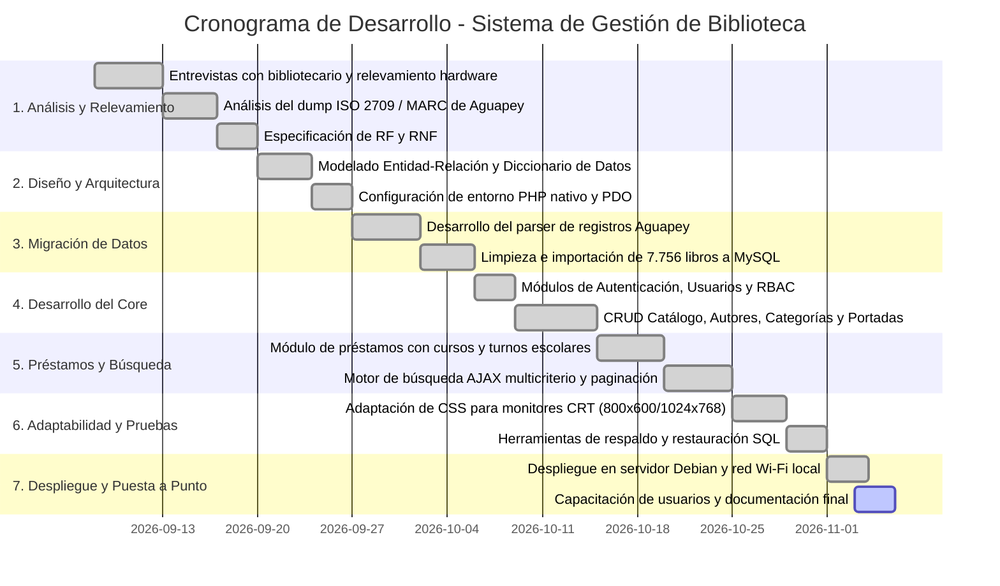
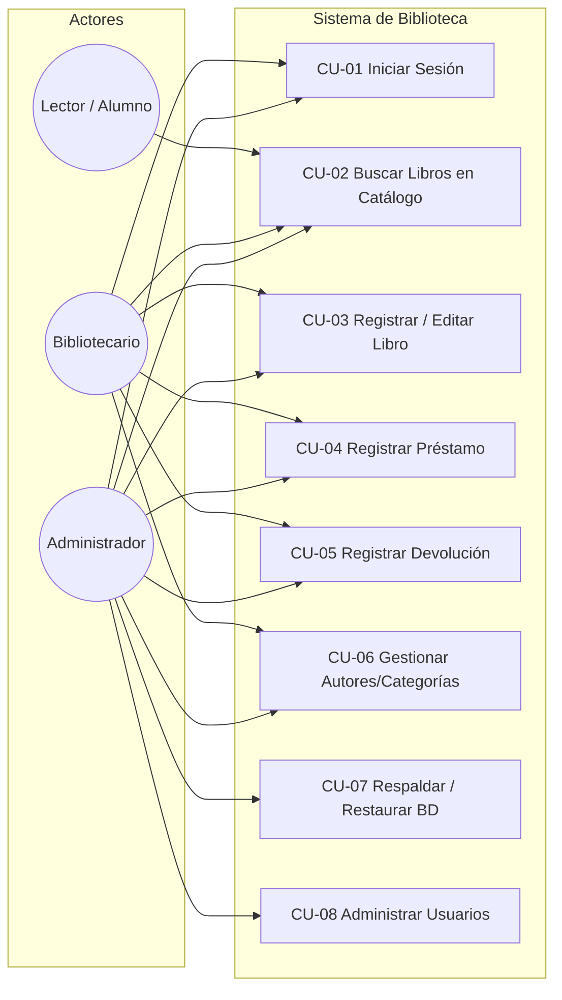
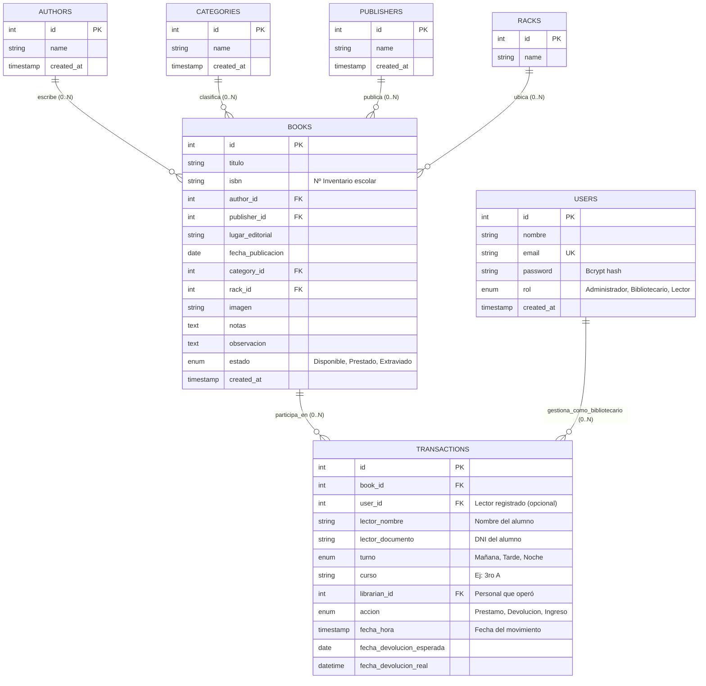

# SISTEMA DE GESTIÓN DE BIBLIOTECA ESCOLAR
## DOCUMENTO DE ESPECIFICACIÓN DE PROYECTO DE SOFTWARE

---

### CARÁTULA

* **Proyecto**: Sistema Integral de Gestión de Biblioteca Escolar e Institucional
* **Institución**: Escuela de Educación Secundaria / Instituto Superior
* **Espacio Curricular / Materia**: Proyecto Final de Prácticas Profesionalizantes / Desarrollo de Sistemas
* **Autores / Equipo de Desarrollo**: Equipo de Desarrollo de Software
* **Destinatario / Cliente**: Equipo de Conducción y Personal de Biblioteca Escolar
* **Versión del Documento**: 2.0 (Producción)
* **Fecha**: Noviembre de 2026
* **Estado**: Implementado y Operativo

---

## 📑 ÍNDICE

1. [Presentación del Proyecto](#1-presentación-del-proyecto)
   - 1.1 Introducción y Justificación
   - 1.2 Problemática Previa
   - 1.3 Solución Propuesta
2. [Objetivos](#2-objetivos)
   - 2.1 Objetivo General
   - 2.2 Objetivos Específicos
3. [Descripción del Dominio del Sistema](#3-descripción-del-dominio-del-sistema)
   - 3.1 Entorno Operativo y Actores
   - 3.2 El Catálogo Bibliográfico y la Identificación (Inventario vs. ISBN)
   - 3.3 El Circuito Transaccional de Préstamos y Devoluciones
   - 3.4 Clasificación y Organización Física
4. [Límites del Sistema](#4-límites-del-sistema)
   - 4.1 Alcance del Sistema (Qué incluye)
   - 4.2 Fuera de Alcance (Qué no incluye)
   - 4.3 Restricciones Tecnológicas y Operativas
5. [Requerimientos Funcionales y No Funcionales](#5-requerimientos-funcionales-y-no-funcionales)
   - 5.1 Requerimientos Funcionales (RF)
   - 5.2 Requerimientos No Funcionales (RNF)
   - 5.3 Matriz de Trazabilidad
6. [Diagrama de Gantt](#6-diagrama-de-gantt)
   - 6.1 Fases y Tareas del Proyecto
   - 6.2 Representación Visual (Gantt)
7. [Casos de Uso](#7-casos-de-uso)
   - 7.1 Diagrama General de Casos de Uso
   - 7.2 Especificación Detallada de Casos de Uso Principales
8. [Diagrama Entidad-Relación (DER)](#8-diagrama-entidad-relación-der)
   - 8.1 Modelo Conceptual / Lógico
   - 8.2 Diccionario de Datos
9. [Anexos](#9-anexos)
   - 9.1 Entrevistas y Relevamiento Inicial
   - 9.2 Código Fuente (No imprimir / Referencia digital)
   - 9.3 Documentación Externa (Guía de Uso para el Usuario)

---

## 1. PRESENTACIÓN DEL PROYECTO

### 1.1 Introducción y Justificación
La biblioteca es el centro neurálgico del acceso al material didáctico, literario y pedagógico de la comunidad educativa. Sin embargo, en numerosos establecimientos educativos públicos y privados, la administración de miles de volúmenes se ha visto obstaculizada por herramientas informáticas obsoletas, rígidas o dependientes de equipos monousuario sin capacidad de interconexión.

El presente proyecto consiste en el diseño, desarrollo, migración e implantación de un **Sistema Web de Gestión de Biblioteca Escolar**. La aplicación centraliza el inventario físico de libros, automatiza el circuito de préstamos a estudiantes y profesores (distinguiendo cursos y turnos escolares), ofrece búsquedas multicriterio en tiempo real y permite operar en red local (LAN/Wi-Fi) desde cualquier computadora, tableta o dispositivo sin requerir conexión a internet.

### 1.2 Problemática Previa
Durante años, la biblioteca operó utilizando **Aguapey** (sistema basado en el estándar bibliotecológico ISIS / MARC) instalado en una única computadora de escritorio:
* **Falta de conectividad de red**: Solo una persona a la vez podía consultar o registrar datos sentada frente a la máquina física de la biblioteca.
* **Formatos cerrados y complejos**: Los datos residían en estructuras ISO 2709 / MARC difíciles de exportar o consultar de forma ágil por personal no catalogador.
* **Lentitud operativa en horas pico**: En los recreos o cambios de turno escolar, la cola de alumnos para pedir o devolver libros provocaba demoras sustanciales.
* **Hardware heterogéneo y antiguo**: En la institución conviven equipos modernos con terminales antiguas (monitores CRT de baja resolución, como 1024x768 u 800x600).

### 1.3 Solución Propuesta
Se implementó un sistema web nativo en PHP 8 y MySQL, diseñado bajo el principio de **cero dependencias externas pesadas**. Se desarrolló un parser extractor que migró más de **7.700 registros catalográficos de Aguapey** directamente a la nueva base relacional, manteniendo la coherencia de autores, editoriales, categorías y el histórico número de inventario escolar.

La interfaz fue diseñada con CSS responsivo adaptativo que funciona tanto en monitores de tubo de 800x600 como en pantallas panorámicas modernas y teléfonos celulares conectados a la red Wi-Fi escolar.

---

## 2. OBJETIVOS

### 2.1 Objetivo General
Desarrollar e implementar un sistema web integral, accesible y de alto rendimiento para la administración del catálogo bibliográfico y el control de préstamos y devoluciones de la biblioteca escolar, optimizado para operar en red local y en hardware con restricciones de resolución.

### 2.2 Objetivos Específicos
1. **Migración de Datos**: Extraer, limpiar e importar el catálogo histórico completo de Aguapey (más de 7.700 libros) conservando la integridad de autores, editoriales y clasificaciones temáticas.
2. **Búsqueda Instantánea Multicriterio**: Proveer un motor de búsqueda asíncrono (AJAX) que permita filtrar en milisegundos por Título, Autor, Número de Inventario, Categoría o Editorial.
3. **Circuito de Préstamos Adaptado a la Escuela**: Registrar la salida y retorno de ejemplares asociando el nombre del alumno, documento, curso (ej. "3ro A") y turno escolar (Mañana, Tarde, Noche).
4. **Respaldo y Seguridad de Datos**: Disponer de herramientas nativas de backup y restauración SQL en un solo clic para salvaguardar la información ante fallas eléctricas o de hardware.
5. **Compatibilidad y Portabilidad**: Garantizar una experiencia visual fluida y sin desbordes horizontales en estaciones de trabajo antiguas con monitores CRT (resoluciones de 800x600 y 1024x768) y terminales móviles conectadas a la red local.

---

## 3. DESCRIPCIÓN DEL DOMINIO DEL SISTEMA

### 3.1 Entorno Operativo y Actores
El sistema interactúa con tres perfiles o roles de usuarios principales:
* **Administrador**: Responsable técnico y directivo con acceso irrestricto. Puede crear y editar usuarios, alterar roles, ejecutar respaldos y restauraciones de la base de datos, además de gestionar todo el catálogo y transacciones.
* **Bibliotecario / Auxiliar**: Personal a cargo de la atención al público. Emite préstamos, procesa devoluciones, añade nuevos libros al inventario y edita autores o categorías.
* **Lector (Estudiante / Docente)**: Perfil de consulta. Puede acceder al catálogo en línea para buscar la disponibilidad de libros y su ubicación física sin facultades de modificación.

```
       ┌────────────────┐         ┌────────────────┐         ┌────────────────┐
       │ Administrador  │         │ Bibliotecario  │         │ Lector/Alumno  │
       └───────┬────────┘         └───────┬────────┘         └───────┬────────┘
               │                          │                          │
               ├──────────────────────────┼──────────────────────────┤
               │                          │                          │
               ▼                          ▼                          ▼
     ┌──────────────────┐       ┌──────────────────┐       ┌──────────────────┐
     │ Configuración y  │       │ Préstamos, Bajas │       │ Búsqueda en vivo │
     │ Respaldos SQL    │       │ y Catálogo       │       │ y Disponibilidad │
     └──────────────────┘       └──────────────────┘       └──────────────────┘
```

### 3.2 El Catálogo Bibliográfico y la Identificación (Inventario vs. ISBN)
En el ámbito de las bibliotecas escolares existe una distinción crucial:
* **Número de Inventario (Marcador 859^a de Aguapey)**: Es el número correlativo propio asignado por la institución y físicamente adherido al libro con una etiqueta (ejemplo: `007819`). Este es el código primario utilizado en el día a día para identificar cada ejemplar físico.
* **Código ISBN (Marcador 020^a de Aguapey)**: Es el identificador comercial internacional. Muchos libros escolares donados o de ediciones históricas carecen de código de barras o ISBN comercial.

Por esta razón, el sistema almacena prioritariamente el **Número de Inventario escolar** como identificador de búsqueda y visualización, asegurando total coincidencia entre la etiqueta física del libro en mano y la pantalla del operador.

### 3.3 El Circuito Transaccional de Préstamos y Devoluciones
Cada ejemplar bibliográfico posee un estado de circulación (`Disponible`, `Prestado`, `Extraviado`):
1. **Emisión de Préstamo**:
   - El bibliotecario busca el libro por su inventario o título.
   - Solo se permite prestar libros en estado `Disponible`.
   - Se registran los datos del solicitante: Nombre, DNI, Turno (`Mañana`, `Tarde`, `Noche`), Curso (ej. "4to 1ra") y la fecha límite de devolución.
   - En una transacción atómica, el estado del libro cambia a `Prestado` y se crea el registro en la tabla de transacciones.
2. **Devolución**:
   - Con un solo clic desde el panel de préstamos activos, se registra la fecha y hora exacta de devolución.
   - El libro retorna inmediatamente al estado `Disponible`.

### 3.4 Clasificación y Organización Física
Los libros se encuentran clasificados en tres dimensiones auxiliares:
* **Autor(es)**: Creadores de la obra (relación normalizada).
* **Categoría**: Clasificación temática o de género (Cuentos, Historia, Ciencias Naturales, etc.).
* **Editorial y Lugar**: Casa publicadora y ciudad de edición.
* **Estante (Rack)**: Ubicación física dentro del recinto de la biblioteca.

---

## 4. LÍMITES DEL SISTEMA

### 4.1 Alcance del Sistema (Qué incluye)
* **Gestión de Catálogo**: Altas, bajas, modificaciones y consultas (CRUD) de libros, incluyendo fotografía de portada, notas internas y observaciones.
* **Normalización de Auxiliares**: CRUD de Autores, Categorías, Editoriales y Estantes.
* **Búsqueda Instantánea Multicriterio**: Filtrado en tiempo real sin recargar página mediante AJAX por Título, Autor, Inventario, Categoría y Editorial.
* **Circuito de Préstamos y Devoluciones**: Registro de salidas y reingresos con control de turno escolar, curso y fecha comprometida.
* **Gestión de Usuarios y Seguridad**: Control de acceso basado en roles (RBAC) con contraseñas encriptadas con algoritmo Bcrypt.
* **Herramientas de Base de Datos**: Módulo de descarga de backups SQL y restauración desde archivo con control de integridad referencial.
* **Visualización Responsiva Universal**: Adaptación completa de interfaz a pantallas táctiles, monitores panorámicos y monitores antiguos de tubo (CRT 800x600 y 1024x768).
* **Operatividad en Red Local (LAN / Wi-Fi)**: Servidor central accesible por dirección IP local por múltiples estaciones simultáneas.

### 4.2 Fuera de Alcance (Qué no incluye)
* **Pasarelas de Pago o Multas Monetarias**: Al ser una biblioteca escolar pública/institucional, no se gestionan cobros de dinero ni sistemas de pago electrónico.
* **Préstamos Interbibliotecarios Globales**: No se sincroniza en tiempo real con redes de bibliotecas externas ni servidores en la nube pública.
* **Lectura Digital de Libros (E-books)**: El sistema gestiona el inventario físico de ejemplares en papel, no almacena PDFs ni lectores de libros electrónicos.
* **Generación de Carnets con Código de Barras Físicos**: Si bien soporta lectores ópticos convencionales mediante emulación de teclado, no incluye software de diseño gráfico de credenciales plásticas.

### 4.3 Restricciones Tecnológicas y Operativas
* **Sin Dependencias de Internet**: El sistema debe poder arrancar, operar y gestionarse en una intranet totalmente aislada de internet.
* **Cero Frameworks Pesados en Frontend/Backend**: No se permite el uso de dependencias complejas (Composer, NPM, Node.js, Webpack) que aumenten el peso del software o dificulten su mantenimiento en servidores institucionales modestos.
* **Compatibilidad de Hardware**: Obligatoriedad de funcionamiento fluido en computadoras con procesadores de gama baja y pantallas de relación de aspecto 4:3.

---

## 5. REQUERIMIENTOS FUNCIONALES Y NO FUNCIONALES

### 5.1 Requerimientos Funcionales (RF)

| Código | Nombre del Requerimiento | Descripción Detallada | Prioridad |
| :---: | :--- | :--- | :---: |
| **RF-01** | Autenticación y RBAC | Validar credenciales de usuario mediante sesiones PHP seguras y aplicar control de acceso según el rol (`Administrador`, `Bibliotecario`, `Lector`). | Alta |
| **RF-02** | Catálogo Bibliográfico CRUD | Permitir crear, editar, listar y eliminar libros con datos completos: Título, Autor, Nº Inventario, Editorial, Lugar, Año, Categoría, Estante, Portada, Notas y Observaciones. | Alta |
| **RF-03** | Búsqueda Multicriterio AJAX | Permitir filtrar el catálogo instantáneamente sin recargar la página por Título, Autor, Inventario, Categoría, Editorial o Estado. | Alta |
| **RF-04** | Registro de Préstamos | Registrar la salida de un ejemplar disponible solicitando Lector, DNI, Turno escolar (`Mañana`, `Tarde`, `Noche`), Curso y fecha estimada de devolución. | Alta |
| **RF-05** | Devolución de Ejemplares | Registrar el reintegro de libros con un clic, almacenando la fecha y hora real de devolución y restableciendo el estado del libro a `Disponible`. | Alta |
| **RF-06** | Gestión de Entidades Auxiliares | Proveer interfaces para la administración independiente de Autores, Categorías, Editoriales y Estanterías físicas. | Media |
| **RF-07** | Indicadores de Dashboard | Presentar métricas en tiempo real de libros totales, disponibles, prestados, autores, categorías y estado de apertura de la biblioteca. | Media |
| **RF-08** | Respaldo de Base de Datos | Generar y descargar un archivo `.sql` autocontenido con la estructura DDL y datos DML completos de la biblioteca. | Alta |
| **RF-09** | Restauración de Base de Datos | Permitir al Administrador subir un archivo SQL para restaurar el sistema, desactivando temporalmente claves foráneas para evitar bloqueos. | Alta |
| **RF-10** | Carga y Vista Previa de Portadas | Permitir subir imágenes JPG/PNG/WEBP para la portada de cada libro, con previsualización en vivo y modal de ampliación. | Baja |

### 5.2 Requerimientos No Funcionales (RNF)

| Código | Categoría | Descripción y Criterio de Aceptación |
| :---: | :--- | :--- |
| **RNF-01** | Rendimiento | Las consultas de búsqueda y paginación sobre los 7.700 libros deben responder en menos de **300 ms** utilizando cláusulas SQL `LIMIT / OFFSET`. |
| **RNF-02** | Seguridad SQL | Toda interacción con la base de datos debe realizarse mediante **PDO con sentencias preparadas** (`ATTR_EMULATE_PREPARES => false`), eliminando riesgos de inyección SQL. |
| **RNF-03** | Seguridad de Claves | Las contraseñas deben almacenarse bajo hash irreversible utilizando la función nativa `password_hash()` con algoritmo **Bcrypt**. |
| **RNF-04** | Usabilidad y Responsive | La interfaz debe adaptarse a resoluciones desde **800x600** (pantallas CRT) hasta **1920x1080**, garantizando que ninguna tabla ni formulario desborde el ancho de pantalla. |
| **RNF-05** | Simplicidad / Cero Dependencias | El código se desarrollará en PHP 8 nativo, CSS3 puro y JavaScript estándar (Vanilla JS), sin frameworks externos que requieran compilación o conexión a internet. |
| **RNF-06** | Integridad Transaccional | Las operaciones que modifiquen múltiples tablas simultáneamente (ej. préstamo de libro) deben ejecutarse en transacciones ACID (`beginTransaction`, `commit`, `rollBack`). |
| **RNF-07** | Disponibilidad en Red Local | El sistema debe ser accesible simultáneamente por múltiples clientes conectados a la misma red local Wi-Fi/LAN mediante la IP del servidor. |

### 5.3 Matriz de Trazabilidad

| Requisito | Caso de Uso | Módulo / Archivos Clave | Tabla(s) Asociadas |
| :---: | :---: | :--- | :--- |
| **RF-01** | CU-01 | [`login.php`](file:///c:/xampp/htdocs/x/Gestion-de-biblioteca-main/Gestion-de-biblioteca-main/login.php), [`auth.php`](file:///c:/xampp/htdocs/x/Gestion-de-biblioteca-main/Gestion-de-biblioteca-main/auth.php), [`logout.php`](file:///c:/xampp/htdocs/x/Gestion-de-biblioteca-main/Gestion-de-biblioteca-main/logout.php) | `users` |
| **RF-02** | CU-02, CU-03 | [`pages/books.php`](file:///c:/xampp/htdocs/x/Gestion-de-biblioteca-main/Gestion-de-biblioteca-main/pages/books.php), [`pages/add_book.php`](file:///c:/xampp/htdocs/x/Gestion-de-biblioteca-main/Gestion-de-biblioteca-main/pages/add_book.php), [`pages/edit_book.php`](file:///c:/xampp/htdocs/x/Gestion-de-biblioteca-main/Gestion-de-biblioteca-main/pages/edit_book.php) | `books`, `authors`, `categories`, `publishers` |
| **RF-03** | CU-02 | [`api/search_ajax.php`](file:///c:/xampp/htdocs/x/Gestion-de-biblioteca-main/Gestion-de-biblioteca-main/api/search_ajax.php) | `books`, `authors`, `categories`, `publishers` |
| **RF-04** | CU-04 | [`pages/issue_books.php`](file:///c:/xampp/htdocs/x/Gestion-de-biblioteca-main/Gestion-de-biblioteca-main/pages/issue_books.php), [`api/search_books_json.php`](file:///c:/xampp/htdocs/x/Gestion-de-biblioteca-main/Gestion-de-biblioteca-main/api/search_books_json.php) | `books`, `transactions` |
| **RF-05** | CU-05 | [`pages/issue_books.php`](file:///c:/xampp/htdocs/x/Gestion-de-biblioteca-main/Gestion-de-biblioteca-main/pages/issue_books.php) | `books`, `transactions` |
| **RF-06** | CU-06 | [`pages/categories.php`](file:///c:/xampp/htdocs/x/Gestion-de-biblioteca-main/Gestion-de-biblioteca-main/pages/categories.php), [`pages/authors.php`](file:///c:/xampp/htdocs/x/Gestion-de-biblioteca-main/Gestion-de-biblioteca-main/pages/authors.php), [`pages/publishers.php`](file:///c:/xampp/htdocs/x/Gestion-de-biblioteca-main/Gestion-de-biblioteca-main/pages/publishers.php) | `categories`, `authors`, `publishers`, `racks` |
| **RF-07** | CU-01 | [`pages/dashboard.php`](file:///c:/xampp/htdocs/x/Gestion-de-biblioteca-main/Gestion-de-biblioteca-main/pages/dashboard.php) | Todas las tablas |
| **RF-08** | CU-07 | [`pages/db_tools.php`](file:///c:/xampp/htdocs/x/Gestion-de-biblioteca-main/Gestion-de-biblioteca-main/pages/db_tools.php), [`api/export_db.php`](file:///c:/xampp/htdocs/x/Gestion-de-biblioteca-main/Gestion-de-biblioteca-main/api/export_db.php) | Estructura completa DDL/DML |
| **RF-09** | CU-08 | [`pages/db_tools.php`](file:///c:/xampp/htdocs/x/Gestion-de-biblioteca-main/Gestion-de-biblioteca-main/pages/db_tools.php) | Estructura completa DDL/DML |

---

## 6. DIAGRAMA DE GANTT

### 6.1 Fases y Tareas del Proyecto
El proyecto se estructuró a lo largo de un ciclo de desarrollo de 8 semanas:
1. **Semana 1**: Relevamiento de requisitos, entrevistas al personal y análisis del formato MARC/ISO de Aguapey.
2. **Semana 2**: Diseño de la base de datos relacional (DER), prototipado de arquitectura y configuración de entornos.
3. **Semana 3**: Desarrollo del parser de migración Aguapey (`migrate_aguapay.php`) e importación de los 7.756 registros.
4. **Semana 4**: Construcción del núcleo del sistema (Catálogo, CRUD de Libros, Autores, Categorías y Editoriales).
5. **Semana 5**: Implementación del módulo de Préstamos y Devoluciones con soporte para turnos y cursos escolares.
6. **Semana 6**: Desarrollo del motor de búsqueda asíncrona en vivo (AJAX) y selector JSON de libros.
7. **Semana 7**: Refactorización de diseño responsivo, adaptación a monitores CRT (800x600/1024x768) y pruebas en red local.
8. **Semana 8**: Pruebas de integración, puesta en producción en servidor Debian Linux, capacitación y entrega de manuales.

### 6.2 Representación Visual (Gantt)



---

## 7. CASOS DE USO

### 7.1 Diagrama General de Casos de Uso



### 7.2 Especificación Detallada de Casos de Uso Principales

#### Caso de Uso CU-01: Iniciar Sesión en el Sistema
* **Actor Principal**: Administrador / Bibliotecario / Lector.
* **Precondición**: El usuario debe tener una cuenta registrada en la tabla `users`.
* **Flujo Principal**:
  1. El usuario accede a la ruta `/login.php`.
  2. El sistema muestra el formulario de autenticación solicitando correo y contraseña.
  3. El usuario ingresa su correo electrónico y contraseña, y presiona "Ingresar".
  4. El sistema busca al usuario por correo y verifica el hash Bcrypt de la contraseña (`password_verify`).
  5. El sistema inicializa la sesión PHP con el ID de usuario, nombre y rol asignado.
  6. El sistema redirige al usuario a la página principal (`pages/dashboard.php`).
* **Flujo Alternativo**:
  - *4a. Credenciales incorrectas*: El sistema emite un mensaje de error "Correo o contraseña incorrectos" y permanece en la vista de login.

---

#### Caso de Uso CU-02: Búsqueda Multicriterio de Libros en Catálogo
* **Actor Principal**: Cualquier usuario autenticado (Lector, Bibliotecario o Administrador).
* **Precondición**: Existen registros bibliográficos cargados.
* **Flujo Principal**:
  1. El usuario ingresa a la sección "Gestionar Libros" (`pages/books.php`).
  2. El sistema muestra la barra de búsqueda y los primeros 25 libros paginados.
  3. El usuario puede escribir un término en el campo de texto (ej. "Gogol", "Matemática", o un número de inventario como "007819").
  4. Opcionalmente, selecciona un criterio en el desplegable (Todos, Título, Autor, Inventario, Categoría, Editorial) y un filtro por estado (Disponible, Prestado, Extraviado).
  5. Al escribir, se dispara una petición AJAX asíncrona hacia `api/search_ajax.php` con técnica de *debounce* (espera 280 ms).
  6. El sistema actualiza el bloque de la tabla instantáneamente sin refrescar la página completa, mostrando las coincidencias y la nueva paginación.
* **Flujo Alternativo**:
  - *6a. No hay coincidencias*: El sistema muestra una fila indicando "No se encontraron libros con los criterios seleccionados".

---

#### Caso de Uso CU-04: Registrar Préstamo de Ejemplar
* **Actor Principal**: Bibliotecario / Administrador.
* **Precondición**: El libro a prestar se encuentra en estado `Disponible`.
* **Flujo Principal**:
  1. El operador ingresa a "Préstamos" (`pages/issue_books.php`).
  2. En el panel izquierdo "Registrar Nuevo Préstamo", el operador busca el libro mediante el campo con autocompletado en tiempo real (`api/search_books_json.php`) por título o número de inventario.
  3. El sistema valida que el libro seleccionado esté `Disponible`.
  4. El operador completa los datos del solicitante:
     - Nombre y Apellido del alumno/a.
     - Documento de Identidad (DNI).
     - Turno escolar (`Mañana`, `Tarde`, `Noche`).
     - Curso (ej. "3ro A").
     - Fecha esperada de devolución.
  5. El operador presiona el botón "Confirmar Préstamo".
  6. El sistema inicia una transacción SQL (`beginTransaction`):
     - Inserta un registro en `transactions` con acción `Prestamo`.
     - Actualiza el estado del libro a `Prestado` en la tabla `books`.
     - Confirma la transacción (`commit`).
  7. El sistema muestra un mensaje de éxito y la tabla de préstamos activos se actualiza inmediatamente.
* **Flujo Alternativo**:
  - *3a. El libro ya se encuentra prestado*: El sistema bloquea la selección e informa que el ejemplar no está disponible.
  - *6a. Falla de base de datos*: El sistema ejecuta `rollBack()` y notifica el error sin alterar datos.

---

#### Caso de Uso CU-05: Registrar Devolución de Ejemplar
* **Actor Principal**: Bibliotecario / Administrador.
* **Precondición**: Existe un préstamo activo registrado.
* **Flujo Principal**:
  1. El operador visualiza el listado de "Préstamos Activos" en `pages/issue_books.php`.
  2. Localiza el préstamo correspondiente al libro o estudiante y pulsa el botón "Devolver".
  3. El sistema solicita confirmación interactiva al operador.
  4. Al confirmar, el sistema ejecuta una transacción:
     - Actualiza la transacción registrando la fecha y hora exacta actual en `fecha_devolucion_real`.
     - Cambia el estado del libro a `Disponible`.
     - Confirma los cambios.
  5. El registro desaparece de la vista de préstamos activos y el libro vuelve a estar inmediatamente apto para un nuevo préstamo.

---

#### Caso de Uso CU-07: Respaldo de Base de Datos
* **Actor Principal**: Administrador.
* **Precondición**: Usuario autenticado con rol `Administrador`.
* **Flujo Principal**:
  1. El administrador ingresa a "Respaldo BD" (`pages/db_tools.php`).
  2. En la sección "Crear Copia de Seguridad", pulsa el botón "Descargar Respaldo Completo (.sql)".
  3. El script `api/export_db.php` inspecciona la estructura de todas las tablas de `library_system`, construye los comandos `DROP TABLE IF EXISTS`, `CREATE TABLE` y todos los bloques `INSERT INTO` escapados.
  4. El navegador descarga automáticamente el archivo con nombre fechado (ej. `respaldo_biblioteca_2026-11-03.sql`).

---

## 8. DIAGRAMA ENTIDAD-RELACIÓN (DER)

### 8.1 Modelo Conceptual / Lógico



### 8.2 Diccionario de Datos

#### 1. Tabla `books` (Libros del Catálogo)
* `id` (INT, Clave Primaria, Auto Incremental): Identificador único interno.
* `titulo` (VARCHAR(255), No Nulo): Nombre o título completo de la obra.
* `isbn` (VARCHAR(50), Nulo): Almacena el **Número de Inventario Escolar** (proveniente del campo 859^a de Aguapey) o el ISBN comercial secundario.
* `author_id` (INT, Clave Foránea -> `authors.id`, Nulo, `ON DELETE SET NULL`): Identificador del autor.
* `publisher_id` (INT, Clave Foránea -> `publishers.id`, Nulo, `ON DELETE SET NULL`): Editorial publicadora.
* `lugar_editorial` (VARCHAR(255), Nulo): Ciudad o país de edición (ej. "Buenos Aires").
* `fecha_publicacion` (DATE, Nulo): Fecha de impresión o copyright.
* `category_id` (INT, Clave Foránea -> `categories.id`, Nulo, `ON DELETE SET NULL`): Categoría o género.
* `rack_id` (INT, Clave Foránea -> `racks.id`, Nulo, `ON DELETE SET NULL`): Estante físico asignado.
* `imagen` (VARCHAR(255), Nulo): Nombre del archivo fotográfico almacenado en `/uploads/books/`.
* `notas` (TEXT, Nulo): Comentarios internos o estado de conservación del ejemplar.
* `observacion` (TEXT, Nulo): Observaciones adicionales visibles.
* `estado` (ENUM('Disponible', 'Prestado', 'Extraviado'), Por defecto 'Disponible'): Condición actual para préstamos.
* `created_at` (TIMESTAMP): Momento de inserción en el sistema.

#### 2. Tabla `transactions` (Movimientos de Préstamo y Devolución)
* `id` (INT, Clave Primaria, Auto Incremental): Identificador del movimiento.
* `book_id` (INT, Clave Foránea -> `books.id`, En cascada): Libro prestado.
* `user_id` (INT, Clave Foránea -> `users.id`, Nulo): Referencia al usuario registrado si el lector posee cuenta en el sistema.
* `lector_nombre` (VARCHAR(255), Nulo): Nombre completo del alumno o profesor prestatario.
* `lector_documento` (VARCHAR(50), Nulo): Número de documento de identidad (DNI).
* `turno` (ENUM('Mañana', 'Tarde', 'Noche'), Nulo): Turno escolar correspondiente al estudiante.
* `curso` (VARCHAR(50), Nulo): División o grado (ej. "1º 2da", "5to Naturales").
* `librarian_id` (INT, Clave Foránea -> `users.id`, En cascada): Usuario del sistema que procesó la operación.
* `accion` (ENUM('Prestamo', 'Devolucion', 'Ingreso'), No Nulo): Tipo de movimiento registrado.
* `fecha_hora` (TIMESTAMP, Por defecto actual): Fecha y hora del préstamo.
* `fecha_devolucion_esperada` (DATE, Nulo): Límite de restitución del libro.
* `fecha_devolucion_real` (DATETIME, Nulo): Momento exacto en que el libro reingresó físicamente a la biblioteca.

#### 3. Tabla `users` (Usuarios del Sistema)
* `id` (INT, Clave Primaria, Auto Incremental): Identificador del operador.
* `nombre` (VARCHAR(100), No Nulo): Nombre y apellido para visualización.
* `email` (VARCHAR(100), Clave Única, No Nulo): Credencial de inicio de sesión.
* `password` (VARCHAR(255), No Nulo): Hash seguro generado con `PASSWORD_BCRYPT`.
* `rol` (ENUM('Administrador', 'Bibliotecario', 'Lector'), Por defecto 'Lector'): Nivel de acceso y privilegios.
* `created_at` (TIMESTAMP): Fecha de registro de la cuenta.

#### 4. Tablas Auxiliares (`authors`, `categories`, `publishers`, `racks`)
* Contienen las columnas canónicas `id` (INT, PK, Auto Increment) y `name` (VARCHAR(255), No Nulo), con restricción `ON DELETE SET NULL` para asegurar que la eliminación de un autor o categoría jamás borre los libros asociados.

---

## 9. ANEXOS

### 9.1 Entrevistas y Relevamiento Inicial

#### Resumen de Entrevista 1: Personal Bibliotecario
* **Fecha**: Septiembre de 2026.
* **Entrevistada**: Bibliotecaria a cargo de los turnos mañana y tarde.
* **Preguntas Clave y Conclusiones**:
  1. *¿Cuál es la mayor dificultad que enfrentan diariamente?*
     > *"En los recreos vienen 15 chicos juntos a pedir libros. En la computadora vieja el sistema Aguapey tarda mucho, no podemos prestar si no tenemos el código exacto y no sabemos rápido si un libro ya se lo llevó otro chico del turno mañana."*
  2. *¿Cómo buscan e identifican los libros en las estanterías?*
     > *"Cada libro tiene una etiqueta pegada en el lomo con el número de inventario que le pusimos acá en la escuela. Casi nunca usamos el ISBN de la imprenta porque los libros viejos no tienen."*
  3. *¿Qué datos necesitan registrar sí o sí en cada préstamo?*
     > *"El nombre del alumno, su DNI, a qué curso va (por ejemplo 3ro B) y el turno, porque si un chico de la tarde no devuelve el libro, tenemos que ubicarlo en su turno."*

#### Resumen de Entrevista 2: Relevamiento de Infraestructura de Hardware
* **Ubicación**: Sala de Biblioteca y Sala de Profesores.
* **Hallazgos Técnicos**:
  - Computadora servidor: PC con procesador x86_64, 4 GB de memoria RAM, conectada al router Wi-Fi escolar.
  - Estaciones cliente disponibles: Terminal de biblioteca con monitor de tubo CRT (resolución nativa de 1024x768 píxeles a 60 Hz) y netbooks escolares con resolución reducida.
  - Conexión a Internet: Intermitente; se requiere que el sistema sea 100% autónomo y funcional en red local interna sin depender de la nube.

---

### 9.2 Código Fuente (No imprimir / Referencia digital)
> [!NOTE]
> Esta sección se incluye con fines de auditoría técnica y trazabilidad de software. Siguiendo las directrices del proyecto, el código fuente completo no se imprime en papel para evitar el desperdicio de cientos de páginas, manteniéndose disponible digitalmente en el repositorio:

* **Punto de Entrada y Configuración**:
  - Conexión PDO e inicialización de entorno: [`config.php`](file:///c:/xampp/htdocs/x/Gestion-de-biblioteca-main/Gestion-de-biblioteca-main/config.php)
  - Control de sesiones y autenticación: [`auth.php`](file:///c:/xampp/htdocs/x/Gestion-de-biblioteca-main/Gestion-de-biblioteca-main/auth.php), [`login.php`](file:///c:/xampp/htdocs/x/Gestion-de-biblioteca-main/Gestion-de-biblioteca-main/login.php)
* **Módulos Operativos (Vistas y Controladores)**:
  - Panel General / Dashboard: [`pages/dashboard.php`](file:///c:/xampp/htdocs/x/Gestion-de-biblioteca-main/Gestion-de-biblioteca-main/pages/dashboard.php)
  - Catálogo de Libros y Filtros: [`pages/books.php`](file:///c:/xampp/htdocs/x/Gestion-de-biblioteca-main/Gestion-de-biblioteca-main/pages/books.php)
  - Alta de Ejemplares: [`pages/add_book.php`](file:///c:/xampp/htdocs/x/Gestion-de-biblioteca-main/Gestion-de-biblioteca-main/pages/add_book.php)
  - Edición y Bajas de Libros: [`pages/edit_book.php`](file:///c:/xampp/htdocs/x/Gestion-de-biblioteca-main/Gestion-de-biblioteca-main/pages/edit_book.php), [`pages/delete_book.php`](file:///c:/xampp/htdocs/x/Gestion-de-biblioteca-main/Gestion-de-biblioteca-main/pages/delete_book.php)
  - Módulo Transaccional de Préstamos: [`pages/issue_books.php`](file:///c:/xampp/htdocs/x/Gestion-de-biblioteca-main/Gestion-de-biblioteca-main/pages/issue_books.php)
  - Clasificaciones Auxiliares: [`pages/authors.php`](file:///c:/xampp/htdocs/x/Gestion-de-biblioteca-main/Gestion-de-biblioteca-main/pages/authors.php), [`pages/categories.php`](file:///c:/xampp/htdocs/x/Gestion-de-biblioteca-main/Gestion-de-biblioteca-main/pages/categories.php), [`pages/publishers.php`](file:///c:/xampp/htdocs/x/Gestion-de-biblioteca-main/Gestion-de-biblioteca-main/pages/publishers.php)
  - Herramientas de Base de Datos: [`pages/db_tools.php`](file:///c:/xampp/htdocs/x/Gestion-de-biblioteca-main/Gestion-de-biblioteca-main/pages/db_tools.php)
* **Endpoints Asíncronos (API)**:
  - Búsqueda en vivo y renderizado parcial: [`api/search_ajax.php`](file:///c:/xampp/htdocs/x/Gestion-de-biblioteca-main/Gestion-de-biblioteca-main/api/search_ajax.php)
  - Búsqueda JSON para préstamos: [`api/search_books_json.php`](file:///c:/xampp/htdocs/x/Gestion-de-biblioteca-main/Gestion-de-biblioteca-main/api/search_books_json.php)
  - Exportador SQL nativo: [`api/export_db.php`](file:///c:/xampp/htdocs/x/Gestion-de-biblioteca-main/Gestion-de-biblioteca-main/api/export_db.php)
* **Scripts de Migración de Datos**:
  - Parser de Aguapey / ISO 2709: [`scripts_y_herramientas/scripts_migracion/migrate_aguapay.php`](file:///c:/xampp/htdocs/x/Gestion-de-biblioteca-main/Gestion-de-biblioteca-main/scripts_y_herramientas/scripts_migracion/migrate_aguapay.php)
* **Estilos e Interfaz**:
  - Hoja de estilos universal responsiva: [`style.css`](file:///c:/xampp/htdocs/x/Gestion-de-biblioteca-main/Gestion-de-biblioteca-main/style.css)

---

### 9.3 Documentación Externa (Guía de Uso para el Usuario)

Esta guía paso a paso está dirigida a los operadores diarios de la biblioteca (Bibliotecarios y Docentes).

#### 1. Cómo ingresar al sistema
1. Abra cualquier navegador web (Chrome, Firefox, Edge) desde su equipo conectado a la red de la escuela.
2. Ingrese a la dirección indicada por el administrador (ejemplo: `http://192.168.1.100/pages/dashboard.php` o `http://localhost/`).
3. Introduzca su correo electrónico y su contraseña personal.
4. Presione el botón **"Ingresar"**. Accederá al Tablero Principal (Dashboard) donde verá el resumen del catálogo y si la biblioteca está abierta.

#### 2. Cómo buscar un libro rápidamente
1. Diríjase en el menú lateral a **Libros ➔ Gestionar Libros**.
2. En la barra superior de búsqueda encontrará un selector de criterios:
   - Puede dejarlo en **"🔍 Todos los campos"** o elegir específicamente: Título, Autor, Nº Inventario, Categoría o Editorial.
3. Escriba su búsqueda en la caja de texto (por ejemplo: el apellido de un autor o el número de inventario de una etiqueta, como `007819`).
4. **No es necesario presionar Enter**: el sistema buscará automáticamente mientras escribe.
5. Cada fila de la tabla le indicará si el libro está **Disponible** (etiqueta verde) o **Prestado** (etiqueta azul).

#### 3. Cómo registrar un préstamo a un alumno
1. En el menú lateral, haga clic en **Préstamos**.
2. En el panel izquierdo de la pantalla verá el formulario **"Registrar Nuevo Préstamo"**:
   - **Buscar Libro**: Empiece a escribir el título o el número de inventario del libro. Aparecerá un menú desplegable con los libros que coinciden y están disponibles. Haga clic sobre el libro deseado.
   - **Nombre del Lector**: Ingrese el nombre y apellido del estudiante o docente.
   - **Documento (DNI)**: Ingrese el DNI del solicitante.
   - **Turno**: Seleccione `Mañana`, `Tarde` o `Noche`.
   - **Curso**: Escriba el curso o división (ej: `3ro A`, `5to 1ra`).
   - **Fecha Límite**: Elija la fecha máxima para devolver el libro.
3. Haga clic en **"Confirmar Préstamo"**. El libro quedará registrado y su estado cambiará a `Prestado`.

#### 4. Cómo registrar la devolución de un libro
1. Diríjase a la sección **Préstamos**.
2. En la tabla derecha verá todos los **"Préstamos Activos"**.
3. Localice el préstamo por el nombre del alumno, curso o título del libro.
4. Presione el botón **"Devolver"** ubicado a la derecha de la fila.
5. Confirme el mensaje en pantalla. El sistema marcará la devolución con la fecha y hora exacta y el libro quedará inmediatamente disponible para ser prestado otra vez.

#### 5. Cómo registrar un nuevo libro en el catálogo
1. En el menú lateral, seleccione **Libros ➔ Gestionar Libros** y pulse el botón azul **"+ Agregar Libro"** (o ingrese a través de **Registrar Nuevo Libro** en el panel).
2. Complete la ficha del libro:
   - **Título**: Nombre de la obra (obligatorio).
   - **Nº de Inventario / ISBN**: El código de la etiqueta pegada en el libro.
   - **Autor, Categoría y Editorial**: Seleccione las opciones correspondientes de las listas desplegables.
   - **Lugar de publicación y Año**: Ciudad y fecha de edición.
   - **Foto de Portada**: Opcionalmente, puede seleccionar una foto del libro desde su computadora.
   - **Notas u Observaciones**: Datos sobre el estado del libro (ej. "Tapa reparada").
3. Presione el botón **"Guardar Libro"**.

#### 6. Cómo realizar una copia de seguridad (Solo Administradores)
1. En el menú lateral, haga clic en **Respaldo BD**.
2. En la tarjeta "Crear Copia de Seguridad", presione el botón **"Descargar Respaldo Completo (.sql)"**.
3. Se descargará a su computadora un archivo que contiene todos los libros, autores y préstamos de la biblioteca. Se recomienda guardar una copia semanal en un pendrive externo para mayor seguridad.

